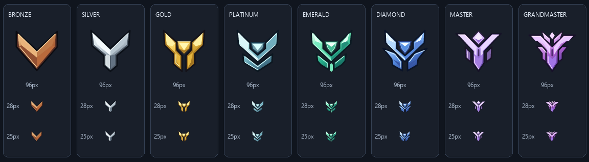

# HOW 자체 경쟁전 엠블럼 SVG

2026-11-06. 실제 티어 시각 자료를 참고해 HOW용으로 새로 그린 **비공식 벡터 세트**다. 공식 이미지 파일이나 공식 자산을 검증했다고 표시하지 않는다. 이전 공식 PNG 두 개와 조사 기록은 보존했으며, 현재 드롭다운은 이 SVG 8종을 사용한다.

## 레퍼런스와 디자인

[등급별 시각 레퍼런스](https://boostpirate.com/tools/overwatch-group-checker)의 8개 이미지를 임시 폴더에서 시각 분석했다. 레퍼런스 파일을 배포 자산으로 복사하거나 SVG 내부에 임베드하지 않았다. 아래 SVG는 새 path 좌표, 금속 명암, 베벨과 하이라이트로 구성했다. 특히 마스터의 레퍼런스는 녹색 계열이지만 사용자가 요청한 보라 계열을 HOW 디자인 결정으로 적용했다. 실제 게임의 공식 색상이 보라색이라고 주장하지 않는다.

| 파일 (public/assets/ranks/) | 분석한 특징 | HOW 디자인 |
|---|---|---|
| bronze.svg | 단일 V, 두꺼운 금속 팔, 중앙 하향 꼭짓점 | 구리·갈색의 넓은 V와 4면 명암 |
| silver.svg | 상단 양팔과 길게 내려오는 Y 기둥 | 회백색 Y, 중앙 이음선과 은색 베벨 |
| gold.svg | 중앙 소형 문양, 양팔 아래 분리 기둥 | 금색 중앙 방패와 분리된 세로 장갑 |
| platinum.svg | 겹친 V, 청록빛 금속, 중앙 문양 | 민트·얼음색 이중 V와 밝은 중앙 플레이트 |
| emerald.svg | 녹색 결정, 복층 장식과 세로 분할 | 초록 보석의 3면과 하단 분리 장갑 |
| diamond.svg | 청색 결정과 넓은 측면 장식 | 파란 중앙 결정, 외측 날개와 대칭 하단 핀 |
| master.svg | 넓은 날개형 Y, 독립 상단 보석과 측면 장식 | 보라색 왕관형 보석·넓은 어깨·긴 중앙 장갑 |
| grandmaster.svg | 여러 겹의 날개, 상단 분기, 높은 장식성 | 자주·보라 3단 날개, 왕관 분기와 하단 장갑 |

모두 viewBox="0 0 96 96", 투명 배경, 동일한 중심선과 정렬 기준이다. 그림자용 래스터나 외부 이미지/폰트/스크립트는 없다. 계층은 실루엣과 중앙 문양으로도 구분되며 색만 바꾸는 복제 방식이 아니다. 25px에서 사라질 만한 글자나 긴 세부 패턴은 넣지 않았다.

## 연결 구조

- src/data/rankAssets.js의 RANK_ASSETS는 8개 SVG를 가리킨다. kind=how-original, status=ready, currentVersionStatus=not-official, permissionStatus=project-authored로 공식 검증 상태와 구분했다.
- 이전 레지스트리는 OFFICIAL_RANK_CANDIDATES로 보존했다. 기존 silver.png/master.png와 NOTICE.txt도 삭제하거나 덮어쓰지 않았다.
- src/views/rankEmblem.js는 자체 제작 자산과 검증된 공식 자산을 별도 경로로 판별한다. 둘 다 로컬 경로만 허용하며 실패 시 기존 등급명 폴백을 유지한다.
- 닫힌 트리거와 열린 옵션은 같은 함수·같은 SVG를 사용한다. *_plus는 동일 SVG와 기존 CSS 원형 + 배지를 재사용한다.
- 기본 박스 28px, 모바일 25px는 유지한다. 브론즈만 opticalScale 1.03, 나머지는 1이다. 실제 브라우저 레이아웃을 계측해 최적화한 값이 아니라 렌더링 프리뷰 기준의 소폭 보정이다.
- all은 텍스트만 사용한다. 그랜드마스터·챔피언 통합 라벨과 기존 16개 값, diamond_plus 기본값을 유지한다. champion/challenger 필터를 추가하지 않는다.
- Vite BASE_URL 기반이라 /HOW/assets/ranks/*.svg로 동작한다. 런타임 외부 CDN 요청을 추가하지 않는다.

## 수정 범위

신규: SVG 8개, 이 문서, HOW-RANK-EMBLEMS-PREVIEW.png.

수정: rankAssets.js, rankEmblem.js, tests/filterCombobox.test.js, public/assets/ranks/NOTICE.txt.

전장 드롭다운·공용 combobox 이벤트·Controller·통계·HOT·Meta v2·라우팅·스냅샷은 수정하지 않았다. 기존 미커밋 작업을 초기화하지 않았다. filters.css의 기존 박스·배지·반응형 스타일도 그대로 재사용했다.

## 시각 검증 범위

SVG는 격리된 node_modules/.cache/how-rank-preview의 resvg로 실제 PNG 렌더링하여 96/28/25px 다크 배경 프리뷰를 확인했다. 미리보기 도구는 앱 의존성이나 package-lock에 추가하지 않았다. PREVIEW.png는 **벡터 렌더링 검증 자료이며 실제 브라우저 스크린샷이 아니다.** PC/모바일 실제 브라우저의 드롭다운 표시·배지 중첩·터치 조작은 미검증이다.

테스트는 SVG 문법, 공통 캔버스, 서로 다른 실루엣, 외부 콘텐츠 없음, 8종 실제 경로, 7개 plus 재사용, 기본값, 이미지 오류, 키보드와 ARIA, 전장 grouping 및 이벤트 회귀를 검사한다.

Commit, Push, PR, 배포 및 자동 수집은 수행하지 않는다.

최종 결과: npm.cmd test **161/161 통과**, npm.cmd run build 통과(67 modules), npm.cmd run verify:pages 통과(/HOW/, 기존 엔트리 자산 6개). 추가로 dist/assets/ranks의 SVG 8개가 원본과 바이트 단위로 동일함을 확인했다. git diff --check 통과(기존 LF/CRLF 경고만 존재), git status 확인. 공용 콤보박스·전장 옵션·heroView·Meta v2·공개 스냅샷/index의 작업 전후 해시가 동일하다.
