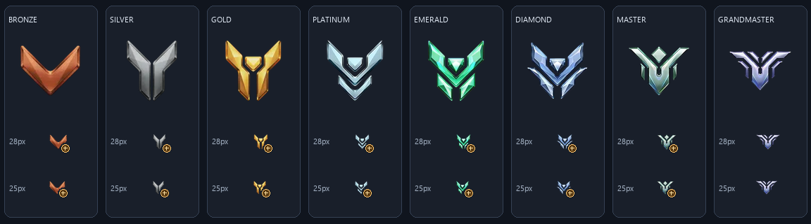

# 사용자 제공 PNG 연결

2026-11-06. 현재 활성 티어 이미지는 HOW SVG가 아닌 사용자 제공 PNG 8종이다. 추가 이미지 검색이나 제작은 하지 않았다.

사용자가 넣은 실제 위치는 public/assets/*.png였다. 원본을 그 자리에 보존하고 public/assets/ranks/*.png로 바이트 변경 없이 복사했다. 8개 등급은 모두 224×224 RGBA다. champion.png도 참고용으로 보관했으며 필터/매핑에 추가하지 않았다.

## 백업

교체 전 public/assets/ranks 전체와 rankAssets.js, rankEmblem.js, filters.css, 관련 테스트를 다음 비공개 로컬 폴더에 백업했다.

`backups/rank-png-switch-20261106-111435-699176/`

기존 파일 해시는 manifest.json에 기록했다. 새 사용자 원본도 같은 백업의 incoming/public/assets에 별도로 보존했다. backups는 기존 .gitignore 규칙으로 제외되며 public이나 dist에 포함하지 않는다. 이전 SVG 8개와 조사용 registry는 삭제하지 않았다.

## 활성 매핑

| 등급 | 파일 | opticalScale | 28px 박스의 가시 높이(계산) |
|---|---|---:|---:|
| bronze | public/assets/ranks/bronze.png | 1.143 | 약 22.0px |
| silver | public/assets/ranks/silver.png | 0.978 | 약 22.0px |
| gold | public/assets/ranks/gold.png | 0.978 | 약 22.0px |
| platinum | public/assets/ranks/platinum.png | 0.978 | 약 22.0px |
| emerald | public/assets/ranks/emerald.png | 0.978 | 약 22.0px |
| diamond | public/assets/ranks/diamond.png | 1.029 | 약 22.0px |
| master | public/assets/ranks/master.png | 1.205 | 약 22.0px |
| grandmaster | public/assets/ranks/grandmaster.png | 1.5 | 약 21.8px |

25px 모바일 박스에서는 가시 높이가 약 19.4~19.7px다. 이는 alpha 영역과 CSS 배율에서 계산한 값이며 브라우저 계측값이 아니다. 원본 비율·색상·파일 바이트는 그대로 유지했다.

rankAssets.js는 Vite BASE_URL을 사용한다. 개발 환경에서는 /assets/ranks/*.png, Pages 기본 빌드에서는 /HOW/assets/ranks/*.png다. root/Pages/중첩 base 경로를 테스트한다. kind=user-local로 기록하며 사용자 제공 파일을 별도 공식 자산 인증을 받은 것처럼 표시하지 않는다.

일반/plus는 같은 PNG를 공유하고 기존 CSS 배지를 사용한다. all은 텍스트 표시, grandmaster는 그랜드마스터·챔피언 통합 라벨이다. 16개 값과 diamond_plus 기본값을 유지했다. 이미지 로드 실패 시 텍스트 폴백이 동작한다.

## 변경 파일

- src/data/rankAssets.js: PNG registry와 base 경로 함수, 이전 HOW registry 보존
- src/data/rankPngMetadata.json: 실제 크기·alpha bounds·배율·SHA256
- src/views/rankEmblem.js: 사용자 선택 로컬 PNG 경로 지원
- tests/filterCombobox.test.js: PNG 8종·plus·base·기본값·오류·접근성 회귀
- scripts/verify-rank-pngs.js: 8종 실파일/해시의 엄격한 검사
- public/assets/ranks/*.png: 사용자 파일 9개(챔피언은 참고용)
- public/assets/ranks/NOTICE.txt: 현재 자산 그룹 고지
- 본 문서 및 USER-RANK-PNG-PREVIEW.png

전장·Meta v2·HOT·통계·스냅샷·routing/controller·CSS를 변경하지 않았다. package.json/package-lock도 수정하지 않았다.

## 시각 검증 범위

8개 원본 파일을 직접 시각 확인했고, 원본과 같은 픽셀을 작은 크기로 렌더링한 미리보기에서 가시 크기와 + 배지를 확인했다. 이 미리보기는 **실제 브라우저 스크린샷이 아니다.** 실제 브라우저 PC/모바일 드롭다운 레이아웃 검증은 미수행이며 DOM/키보드 검증과 구분한다.

Commit, Push, PR, 원격 수정, 배포는 수행하지 않는다.

최종 검증: npm.cmd test **162/162 통과**, npm.cmd run build 통과(68 modules), npm.cmd run verify:pages 통과, git diff --check 통과(기존 LF/CRLF 경고만 존재). node scripts/verify-rank-pngs.js도 **8/8 통과**했다. 로컬 preview에서 /HOW/assets/ranks의 8개 파일 모두 HTTP 200, image/png, 원본과 동일한 바이트임을 확인했다. 백업 manifest의 모든 해시와 원본/복사본/dist의 PNG 9개 해시도 확인했다. 공용 드롭다운·전장 옵션·heroView·Meta v2·스냅샷/index 해시는 이전과 동일하다.
